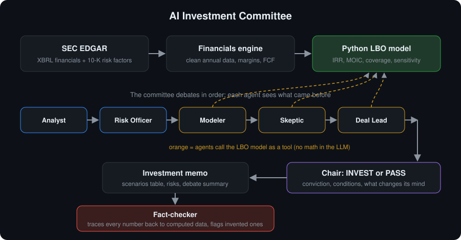

# AI Investment Committee

Five AI agents run a private equity investment committee on any US public company. They pull the company's real financials from SEC filings, model a leveraged buyout, argue about it, and vote to **INVEST** or **PASS**.

## How it works



| Agent | Job |
|---|---|
| Analyst | Judges business quality: growth, margins, cash conversion, existing debt |
| Risk Officer | Picks the 4 risks from the 10-K that matter for a buyout and links each to a model assumption to stress |
| Modeler | Runs base, upside, and downside cases with the LBO tool |
| Skeptic | Stress-tests the Risk Officer's scenarios with the tool and argues to pass |
| Deal Lead | Rebuts the Skeptic, concedes what's true, and proposes terms that still work |
| Chair | Returns a structured decision: INVEST/PASS, conviction, conditions |

**Design choices**
- **LLMs never do the math.** Agents choose assumptions; a tested Python LBO model computes IRR, MOIC, leverage, and interest coverage.
- **Decision guardrail.** If the Chair votes INVEST but the Deal Lead's final terms, as actually modeled, miss the fund's hurdle IRR, code overrides the vote to PASS. Agents can't talk their way past the math.
- **Market terms are locked.** The purchase multiple and interest rate come from the user (the seller's price and lenders' rate). Agents can stress them upward but can't "fix" a deal by assuming a cheaper price or cheaper debt.
- **Correct LBO pricing.** The purchase price is set on the company's actual latest EBITDA; margin and growth stresses only change the projected years.
- **Hallucination check.** `factcheck.py` extracts every number from the final memo and matches it against the data the system computed (in $, $M, $B, and %), then flags anything it can't trace.
- **No agent framework.** The tool-calling loop is about 20 lines in `agents.py`, so the orchestration is fully visible.
- **Real data handling.** XBRL tag fallbacks (companies rename revenue tags over time), full-year filtering, restated numbers preferred.

## Run it

```bash
pip install -r requirements.txt

# The SEC requires a contact in the User-Agent header
export SEC_USER_AGENT="Your Name your_email@example.com"

# Pick ONE model provider:
export GROQ_API_KEY="gsk_..."   # free tier: get a key at console.groq.com/keys
# export GEMINI_API_KEY="..."   # or Google Gemini (free tier, aistudio.google.com)
# export OPENAI_API_KEY="sk-..."  # or OpenAI (paid)
# optional: export LLM_MODEL="model-name" to override the default model

streamlit run app.py
```

On Windows PowerShell use `$env:SEC_USER_AGENT="..."` instead of `export`.

Tip: use mid-size, stable businesses (e.g. CHD, CLX, HRB, DPZ). Mega-caps like AAPL are too large for any real LBO, and the model warns you.

## Tests

```bash
python -m pytest -q
```

Tests run offline: LBO math checked against a hand calculation, pricing behavior under margin stress, the decision guardrail, XBRL parsing edge cases, and a full committee meeting with a scripted fake model (which also checks that the fact-checker catches an invented IRR).

## Project layout

```
app.py                    Streamlit UI
committee/sec_data.py     SEC EDGAR API calls, 10-K risk section extraction
committee/financials.py   XBRL -> clean annual financials + ratios
committee/lbo.py          LBO model + sensitivity grid
committee/agents.py       Agent roles, tool-calling loop, meeting orchestration
committee/factcheck.py    Number verification for the memo
committee/llm.py          Model wrapper: Groq, Gemini or OpenAI, or a fake model in tests
tests/                    Offline unit + end-to-end tests
```

## Limitations
- Simplified LBO: single debt tranche, no transaction fees, no dividends during the hold.
- Entry price is set by the user (no live market data); set it near the company's real trading multiple for realistic results.
- Not investment advice.
